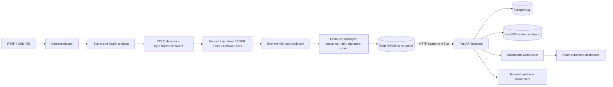
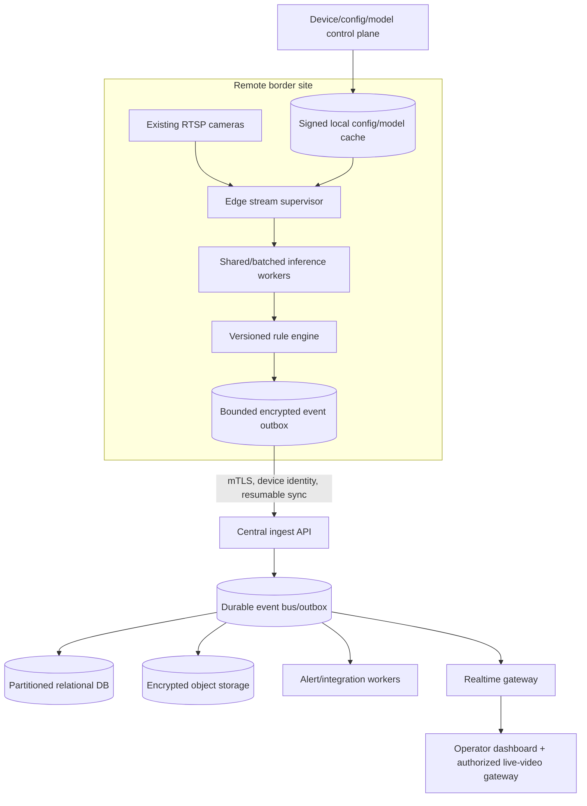

# SIH 26187 – IBVAP Complete Codebase Audit

Audit date: 2026-09-23  
Repository: `D:\netraksh\netraksh`  
Mode: read-only technical audit; no application source was changed  
Problem statement: SIH 26187, AI-Based Intelligent Video Analytics Platform for Border Surveillance using Existing CCTV Infrastructure

## 1. Executive Summary

NETRAKSH is a substantial prototype, not an empty UI or filename-only submission. It contains a real edge video pipeline, YOLO inference, Ultralytics tracking, rule-based events, evidence signing/encryption, offline event queuing, a FastAPI/PostgreSQL control plane, JWT/RBAC, WebSocket updates, webhook integration, and a React operator dashboard. The strongest parts are the modular event/evidence design, edge store-and-forward concept, API surface, role checks, and honest benchmark artifacts that identify measurements which are not available.

It is not currently a deployable, verified implementation of SIH 26187. Both production Docker paths have deterministic dependency/artifact defects; the Compose flow does not run migrations; the available Python environments are non-portable and could not execute the test suite; face recognition is unusable in the shipped edge image; ANPR is prototype-grade; live multi-camera capacity is unmeasured; and uploaded surveillance video is mounted without authentication. Several cross-layer defects also undermine correctness: COCO bicycle class 1 is mapped to `PERSON`, health WebSocket fields do not match the UI, optional ANPR/face metadata is lost before persistence, and contextual evidence fields are excluded from the cryptographic signature.

Strictly applying the requested status vocabulary to the 26-row major-capability matrix gives: **0 WORKING, 13 PARTIALLY WORKING, 11 IMPLEMENTED BUT UNVERIFIED, 1 BROKEN, and 1 NOT IMPLEMENTED**. “0 WORKING” does not mean there is no real code; it means no major end-to-end SIH capability could be independently executed in the supplied environment. The frontend production build and lint did succeed, and all 205 first-party Python files inspected by the audit AST check parsed successfully.

Build status is **FAIL** overall: frontend compilation passes, but the integrated Python/Docker application cannot be reproduced from the checked-in manifests without remediation.

## 2. Repository Inventory

High-level first-party tree (generated/vendor environments such as `node_modules`, `venv*`, `.git`, `opencv_zoo`, caches, and build outputs are excluded):

```text
netraksh/
├── backend/                 FastAPI control plane, ORM, auth, APIs, services
│   ├── api/                 alerts, analytics, audit, auth, cameras, events,
│   │                        integrations, system, dashboard, WebSocket
│   ├── database/            SQLAlchemy engine/session and migration checks
│   ├── models/              ORM entities
│   ├── observability/       Prometheus metrics/middleware
│   ├── security/            JWT, RBAC, edge auth, evidence storage
│   └── services/            escalation, correlation, webhooks, storage
├── edge/                    Per-camera analytics process
│   ├── detection/           YOLO/ONNX runtimes, face, ANPR, tracking helpers
│   ├── ingestion/           OpenCV camera/RTSP adapter
│   ├── rules/               fence, line, loitering, abandoned object, behavior
│   ├── evidence/            snapshots, signing, encryption, hash chain
│   ├── sync/                local SQLite queue and backend synchronization
│   ├── health/              camera health and scene conditions
│   └── instrumentation/     runtime metrics
├── frontend/                React 19 / Vite 8 single-page dashboard
├── shared/                  Pydantic contracts, enums, crypto version profiles
├── alembic/                 database migrations and baseline
├── tests/                   80 Python test files across unit/integration/e2e
├── scripts/                 benchmark, calibration, setup, and utility scripts
├── demo/                    sample videos, telemetry, and zone configuration
├── docs/                    design, limitation, benchmark, and phase reports
├── models/                  model/calibration material
├── certs/                   edge public certificate material only in this tree
├── docker-compose*.yml      local/integration deployment definitions
├── render.yaml              Render blueprint
├── requirements*.txt        Python dependency variants
├── yolov8n.pt               6.5 MB Ultralytics model weight
├── lpd_yunet.onnx           4.1 MB plate-localization model
├── face_recognition_sface_2021dec.onnx  38.7 MB face model
└── edge_private.pem         local ignored private-key material (sensitive)
```

Entry points are `backend/main.py :: app`, `edge/main.py :: main()/EdgePipeline`, and `frontend/src/main.jsx`. `docker-compose.yml` intends to start PostgreSQL, MinIO, backend, edge, frontend, and Nginx. `start_netraksh.cmd` is a local/demo launcher. No active CI workflow was found under `.github`.

Model and data observations:

- `yolov8n.pt` is a plausible real Ultralytics weight; execution was not possible in this audit environment.
- `lpd_yunet.onnx` is 4.1 MB; `license_plate_detection_lpd_yunet_2023mar.onnx` is only 132 bytes and is not a usable model artifact.
- The SFace ONNX file is present, but the integrated face execution path has wiring/dependency defects described below.
- `demo/videos`, `demo/scripts/zones_config.json`, calibration manifests, and benchmark JSON/Markdown exist. There is no production training pipeline or owned, labeled SIH evaluation dataset.
- `recover.ipynb` exists, but notebooks are not part of the active runtime.

The Git working tree was already heavily modified and contained many untracked files before the audit. The audit did not discard, stash, reset, commit, or edit any of that work.

## 3. Technology Stack

| Layer | Actual implementation | Evidence |
|---|---|---|
| Backend | Python, FastAPI 0.115, Uvicorn, REST, WebSocket | `backend/main.py`, `backend/api/*.py`, `requirements-backend.txt` |
| Data | SQLAlchemy 2; PostgreSQL production; SQLite development/test | `backend/models/orm.py`, `backend/database/session.py`, `alembic/` |
| Authentication | HS256 JWT, Passlib/bcrypt, HTTP bearer, ADMIN/OPERATOR/AUDITOR RBAC | `backend/security/auth.py`, `backend/api/auth.py` |
| Edge ingestion | OpenCV `VideoCapture`, background reader thread, bounded frame queue | `edge/ingestion/camera_adapter.py :: CameraAdapter` |
| Detection | Ultralytics YOLO (`yolov8n.pt`); custom ONNX Runtime path; TensorRT via ORT provider selection | `edge/detection/runtime.py` |
| Tracking | Ultralytics ByteTrack/BOTSORT plus histogram/spatial continuity guard | `edge/detection/detector.py`, `edge/config/*.yaml` |
| Face | Haar/optional RetinaFace detection; LBPH; SFace/ONNX experimental paths | `edge/rules/modules.py :: FaceDetectionModule`, `edge/detection/face_recognition.py` |
| ANPR | heuristic or YuNet localization, EasyOCR, CLAHE, optional temporal fusion | `edge/detection/anpr.py`, `edge/rules/modules.py :: ANPRModule` |
| Rules | normalized polygons/lines, fence state, line direction, dwell, stationary-object and behavior state machines | `edge/rules/modules.py`, `edge/rules/behavior_analytics.py` |
| Evidence | JPEG/AES-GCM snapshot storage, SHA-256 hash chain, Ed25519 signature | `edge/evidence/packager.py`, `shared/crypto.py`, `backend/security/evidence_storage.py` |
| Offline sync | Edge-local SQLite queue, retry/backoff, HTTP sync | `edge/sync/local_queue.py`, `edge/sync/sync_client.py` |
| Frontend | React 19, React Router, Vite 8, Leaflet, Recharts, Lucide | `frontend/package.json`, `frontend/src/` |
| Observability | structured logging, Prometheus middleware, pipeline metrics persisted and streamed | `backend/observability/`, `edge/instrumentation/metrics.py`, `backend/api/system.py` |
| Object storage | local filesystem or S3-compatible abstraction; MinIO in Compose | `backend/security/evidence_storage.py`, `docker-compose.yml` |
| Deployment | Docker/Compose, Nginx, Render blueprint; no Kubernetes or queue broker | Dockerfiles, `docker-compose*.yml`, `render.yaml` |

PyTorch is reached through Ultralytics. ONNX Runtime, EasyOCR, RetinaFace, and OpenCV contrib are feature-dependent, but the active edge dependency manifest does not install all of them. No Redis, Kafka/RabbitMQ, vector database, Kubernetes operator, ONVIF library, HLS server, SMS/email/push service, or specialized smart-camera dependency is implemented.

## 4. Architecture

The intended design is distributed: one edge process performs decoding and analytics close to a camera; the central backend accepts compact telemetry/events/evidence; a browser consumes REST and one dashboard WebSocket.



Important reality checks:

- “Multi-camera” is achieved by running separate `EdgePipeline` processes, each loading its own model. There is no supervisor/control plane that schedules or isolates 5–100 streams.
- Live browser video is not streamed from RTSP. The dashboard video workflow is an uploaded/prerecorded file served by the backend while edge telemetry is overlaid.
- The backend is not the inference engine. Its responsibilities are identity, persistence, correlation, alert lifecycle, evidence access, analytics, integration, and UI delivery.
- Global mutable dictionaries hold current demo state, latest telemetry, WebSocket clients, webhook debounce state, and some rate-limit state. These do not work coherently across multiple backend replicas.

Authentication/data-control flow:

```mermaid
sequenceDiagram
  participant U as User
  participant F as React UI
  participant B as FastAPI
  participant DB as Database
  U->>F: username/password
  F->>B: POST /api/auth/token
  B->>DB: verify active user + bcrypt
  B-->>F: HS256 bearer JWT
  F->>B: REST Authorization: Bearer
  B->>DB: reload active user; apply role/command scope
  F->>B: WS /ws/dashboard?token=JWT
  B-->>F: role-filtered messages
```

REST authentication reloads the active user from the database. WebSocket authentication validates the token, but non-operator roles are not consistently revalidated against current database active state, creating a revocation gap.

## 5. Application Startup Flow

Intended local flow:

1. Load settings from environment via `backend/config.py`.
2. Start PostgreSQL and optional MinIO using Compose.
3. Build/start `backend/Dockerfile`; `backend/main.py` initializes logging, middleware, routers, tables/bootstrap checks, and background webhook processing.
4. Start one or more `edge/main.py` processes with camera ID, source, model, zones, backend URL, signing keys, and edge authentication.
5. Build the Vite frontend with `VITE_BACKEND_URL`; serve with the frontend Nginx container.

The checked-in production path cannot complete this sequence:

- `backend/Dockerfile` installs only `requirements-backend.txt`; that file omits `prometheus-client` imported during `backend.main` import and `alembic` imported by the production migration check. It also omits `boto3` for S3 mode.
- The backend image copies `certs/ca` and `certs/server`, but these paths are absent in the inspected worktree, so the Docker build itself is expected to fail.
- `backend/database/session.py :: check_alembic_revision()` rejects a fresh production database whose revision is not at Alembic head, while `docker-compose.yml` has no migration job or `alembic upgrade head` step.
- `edge/Dockerfile` installs `edge/requirements.txt`, which omits `httpx` imported at module load by `edge/sync/sync_client.py`. It also uses non-contrib OpenCV even though LBPH calls `cv2.face.LBPHFaceRecognizer_create()`.
- The edge image does not copy or mount the default `yolov8n.pt` or demo video, and `edge/main.py` fails fast if the configured model does not exist.
- Compose does not provision the edge bearer token, model/video volume, or a complete CORS origin configuration. The browser and backend are on different localhost ports by default, while production disallows permissive CORS.
- `render.yaml` points at the backend-only Dockerfile while describing a single-container/full application deployment; it defines no managed database resource, frontend build, edge process, or migrations.

## 6. Runtime Data Flow

`CameraAdapter` opens the configured source through OpenCV, reads on a daemon thread, and writes to a 30-frame drop-oldest queue. It reconnects with exponential backoff and jitter after open/read failure. The main loop classifies scene/camera health, optionally gates inference, runs YOLO plus tracking, computes rule events, and posts latest telemetry separately from event evidence.

For an event, `EdgePipeline._process_rules()` uses the track and normalized zones. `EventVerifier.observe()` applies per-key confirmation/cooldown. `_emit_event()` calls `EvidencePackager`, stores a local snapshot/hash-chain record, and enqueues the envelope in edge SQLite. The sync client posts to `POST /api/events`, then uploads evidence separately. The backend validates schema/auth/signature where configured, stores ORM rows, performs correlation/escalation, commits alerts, broadcasts WebSocket messages, and attempts configured webhooks.

Data locations:

| Data | Storage |
|---|---|
| users, cameras, events, alerts, audit logs, webhook subscriptions, watchlist | SQLAlchemy relational database |
| latest track telemetry | one `analysis_telemetry` row per camera/stream plus in-memory cache |
| performance history | append-only `pipeline_metrics` rows |
| edge pending events | edge-local SQLite queue |
| edge snapshots/clips | local edge filesystem, optionally encrypted |
| uploaded demo videos | `demo/videos` local filesystem |
| backend evidence | local filesystem or S3-compatible store |
| face enrollment | raw base64 JPEG crops in `watchlist_face_images` |
| embeddings | not durably stored; derived/in-memory experimental indexes |
| zone configuration | JSON file, normally `demo/scripts/zones_config.json` |

Failure semantics are mixed. Events already packaged are durable offline; current telemetry, camera health updates, and WebSocket messages are lossy. `_emit_event()` catches broad exceptions, so disk-full/packaging failures can log and drop an event before it reaches the durable queue.

## 7. SIH Requirement Traceability Matrix

The matrix is the counting source for the final summary. “Verification” means this audit’s verification, not a repository comment or historic claim.

| ID | SIH requirement | Status | Evidence/current implementation | Verification and gap | Severity / later work |
|---:|---|---|---|---|---|
| 1 | CCTV/IP/RTSP ingestion | PARTIALLY WORKING | `edge/ingestion/camera_adapter.py`; OpenCV accepts RTSP/HTTP/USB/file, queue and reconnect | Static path confirmed; no live camera test; no open/read timeout, ONVIF, HLS, credential lifecycle | HIGH: bounded timeouts, real RTSP soak tests |
| 2 | Human detection | IMPLEMENTED BUT UNVERIFIED | `edge/detection/runtime.py :: PyTorchRuntime`; YOLO class 0 | Model file exists, runtime not executable here; class 1 bicycle is incorrectly mapped as person | HIGH: fix map and ground-truth benchmark |
| 3 | Human tracking | IMPLEMENTED BUT UNVERIFIED | `edge/detection/detector.py`; ByteTrack/BOTSORT and continuity guard | Source traced; stable IDs not executed; no learned ReID | HIGH: MOT tests and occlusion metrics |
| 4 | Vehicle detection | IMPLEMENTED BUT UNVERIFIED | YOLO classes 2/3/5/7 and vehicle subtypes | Source traced; no current precision/recall run | MEDIUM: labeled border-domain evaluation |
| 5 | Vehicle classification | PARTIALLY WORKING | COCO detector labels car/motorcycle/bus/truck | Generic object-detector class, not a dedicated classifier; no subtype accuracy | MEDIUM: validate/domain-tune |
| 6 | Face detection | IMPLEMENTED BUT UNVERIFIED | Haar cascade and optional RetinaFace in `FaceDetectionModule` | Real detector code; not run; only person tracks in verification zones | HIGH: low-resolution/night testing |
| 7 | Facial recognition/identification | BROKEN | LBPH/SFace code and watchlist API exist | Edge image lacks `cv2.face`; SFace call path supplies no aligned crop; separate `embedding` index is not populated by backend sync | CRITICAL: unify and validate one supported engine |
| 8 | ANPR | PARTIALLY WORKING | heuristic/YuNet localization, EasyOCR, normalizer, fusion | Default is heuristic crop; no Indian format validation; plate watchlist is a stub; no search; enhanced path not default | HIGH: complete and benchmark end-to-end |
| 9 | Virtual fence | IMPLEMENTED BUT UNVERIFIED | normalized polygons and centroid transition in `VirtualFenceModule` | Source traced; zones are file-only; bbox center can misclassify tall/overlapping objects | HIGH: feet-point/intersection option and configuration API |
| 10 | Intrusion/line crossing | IMPLEMENTED BUT UNVERIFIED | `LineCrossingModule`, restricted direction, cooldown | Source traced; not runtime-verified; no dashboard zone authoring | HIGH: integration tests and admin workflow |
| 11 | Suspicious activity | PARTIALLY WORKING | loitering, stationary/abandoned object, rapid approach, repeated crossing, sustained direction | Rule-based, several fixed pixel/time thresholds; advanced engine off by default; no violence/weapon/action model | HIGH: coordinate/threshold correction and validation |
| 12 | Night movement | PARTIALLY WORKING | brightness condition, optional CLAHE, frame-difference fallback | CLAHE default disabled; fixed motion thresholds; generic daylight YOLO; no IR/thermal or low-light benchmark | HIGH: real night dataset and tuning |
| 13 | Object tracking | IMPLEMENTED BUT UNVERIFIED | same ByteTrack/BOTSORT path for mapped person/vehicle classes | No general-object classes or current IDF1/MOTA; per-camera only | MEDIUM: scope/measure tracking |
| 14 | Real-time alerts | PARTIALLY WORKING | alert ORM/API, WebSocket, severity, ack/close, webhook | No email/SMS/push; webhook is blocking/no retry/signature; one watchlist dispatch path is simulated | HIGH: reliable delivery/outbox |
| 15 | Event logging | PARTIALLY WORKING | event ORM, hash chain, evidence, audit log | Strong structure; optional context not signed; some failures are log-and-drop; audit coverage incomplete | HIGH: integrity profile and failure guarantees |
| 16 | Multi-camera operation | PARTIALLY WORKING | camera registry and one edge process per camera | No orchestration; model duplicated per process; multistream benchmark says NOT EXECUTED | HIGH: supervisor and capacity tests |
| 17 | Command dashboard | PARTIALLY WORKING | React pages for alerts, analytics, evidence, cameras, map, health, performance, watchlist | Frontend builds; no live RTSP view/zone editor/ANPR search/user admin; field mismatches and demo paths | HIGH: close real-data gaps |
| 18 | Evidence capture | IMPLEMENTED BUT UNVERIFIED | snapshot/clip packager, AES-GCM, SHA-256, Ed25519, upload/verify | Static trace only; event-stage benchmark counts are zero; context excluded from signature | HIGH: end-to-end tamper tests |
| 19 | Authentication | IMPLEMENTED BUT UNVERIFIED | bcrypt + JWT + active-user lookup | Source/test inventory supports it; test runtime unavailable; no lockout/MFA/refresh/revocation list | HIGH: run security tests and harden |
| 20 | Role-based access | IMPLEMENTED BUT UNVERIFIED | ADMIN/OPERATOR/AUDITOR dependencies and command filter | Broad route protection traced; WebSocket revocation and internal-sync gaps remain | HIGH: authorization matrix tests |
| 21 | API/C2 integration | PARTIALLY WORKING | REST export and admin webhooks | Basic HTTP JSON only; no standard C2 adapter, retry, HMAC, allowlist, or async outbox | HIGH: secure reliable adapter |
| 22 | Remote deployment | PARTIALLY WORKING | edge processing, local queue, reconnect, Docker restart policy | Shipped containers fail; no watchdog/OTA/config sync/storage quota/power-loss qualification | CRITICAL: reproducible edge appliance |
| 23 | Offline resilience | PARTIALLY WORKING | SQLite event queue and evidence retained locally | Only packaged events durable; health/telemetry/config/watchlist are not; queue/storage unbounded | HIGH: retention, backpressure, recovery tests |
| 24 | Scalability | NOT IMPLEMENTED | no broker/worker scheduler/shared WebSocket state | No 5/10/25/50/100 camera measurements; single-node/global-state architecture | HIGH: measured distributed design |
| 25 | Cybersecurity | PARTIALLY WORKING | production secret checks, RBAC, mTLS option, rate limiting, crypto evidence | public videos, SSRF, shared token impersonation, query JWT, local keys, missing login rate limit | CRITICAL: threat-model remediation |
| 26 | Cost-effective existing-CCTV deployment | IMPLEMENTED BUT UNVERIFIED | CPU-oriented YOLOv8n/OpenCV edge, RTSP concept, no smart-camera dependency | No target hardware bill, power profile, live CCTV qualification, or reproducible image | MEDIUM: target-device acceptance test |

Status totals: WORKING 0; PARTIALLY WORKING 13; IMPLEMENTED BUT UNVERIFIED 11; BROKEN 1; NOT IMPLEMENTED 1.

## 8. AI / Computer Vision Audit

### Detection and tracking

`edge/detection/runtime.py :: PyTorchRuntime.infer()` really invokes Ultralytics `YOLO.predict()` with configured confidence/device/classes. The ONNX runtime performs resize/blob inference, confidence filtering, coordinate scaling, and NMS (0.45). CUDA/TensorRT support is provider/configuration dependent rather than guaranteed. `edge/main.py` checks for the model file and fails fast.

The class map contains a correctness defect: COCO class 1 is bicycle, but `_YOLO_CLASS_MAP` maps both 0 and 1 to `PERSON`. This can generate false human tracks, fence events, and alerts. Vehicles are mapped from COCO car, motorcycle, bus, and truck classes. “Vehicle classification” is therefore the subtype emitted by the generic detector, not a separate fine-grained make/model or military/civilian classifier.

`DetectionTrackingOrchestrator` uses real Ultralytics `track(..., persist=True)` with ByteTrack/BOTSORT. The continuity guard uses centroid distance, time, class, and color histogram to reconnect lost IDs. It is not a learned ReID model and cannot provide a stable identity across cameras. The repository’s latest benchmark states detector+tracker mean 41.61 ms, p95 50.64 ms, effective 24 FPS on one 768×576 file, but also explicitly states no ground truth, no IDF1/MOTA, and hardware “NOT MEASURED” (`docs/PHASE3_AI_BENCHMARK.md`). Those historical values are not treated as an independent audit result.

### Face pipeline

Face detection is distinct from recognition. Haar detection is bundled; RetinaFace is optional. Enrollment uses admin-submitted base64 face crops. LBPH training is rebuilt from synchronized images; SFace code derives embeddings and cosine-searches an in-memory index.

The active integration is broken for deployment:

- `edge/requirements.txt` installs `opencv-python-headless`, not `opencv-contrib-python-headless`; `WatchlistFaceRecognizer.__init__()` unconditionally calls `cv2.face.LBPHFaceRecognizer_create()` before engine selection.
- `FaceDetectionModule` treats only engine name `embedding` as its alignment/embedding path. With `FACE_RECOGNITION_ENGINE=sface`, it calls `recognizer.recognize(face_crop)` without `aligned_face_color`; the SFace recognizer returns no result.
- The separate `embedding` path creates `EmbeddingWatchlistIndex` inside `FaceDetectionModule`, but backend watchlist synchronization trains the different `WatchlistFaceRecognizer`; no enrollment populates the module-local index.
- There is no liveness/anti-spoofing, duplicate enrollment management, calibrated ROC, open-set benchmark, or durable embedding store.

The historic SFace microbenchmark reports ~20.657 ms/face on one CPU, but it does not prove the integrated route works (`docs/PHASE6_SFACE_BENCHMARK.md`).

### ANPR

Default `ANPR_PIPELINE=legacy` takes the lower portion of a tracked vehicle box, thresholds it, and runs EasyOCR. It accepts the highest OCR result without an application minimum confidence, Indian registration grammar, or temporal consensus. The enhanced implementation contains a YuNet localizer, CLAHE/OCR, normalization, and two-observation fusion, but `EnhancedANPRModule()` defaults to heuristic localization unless explicitly constructed otherwise. `PlateWatchlist.match()` always returns `None`.

Even when enhanced metadata is produced, `edge/evidence/packager.py` and backend event mapping persist only a subset, so raw/normalized text, localization confidence, OCR confidence, observations, processing method, fusion state, advanced face details, and behavior detail can be lost between edge and API response. There is no plate search/watchlist UI or indexed plate-history workflow. The LPD benchmark correctly says all accuracy/performance values are NOT EXECUTED/NOT MEASURABLE (`docs/PHASE6_ANPR_LPDYUNET_BENCHMARK.md`).

### Fence, behavior, and night

Fence polygons use the normalized bounding-box centroid. Line rules calculate side transitions and optional restricted direction. File-backed zones include fence, trip line, checkpoint, and verification types. There is no database/API/UI zone lifecycle.

Suspicious activity is rule/tracking based:

- loitering: tracked centroid remains in a zone past a wall-clock dwell threshold;
- abandoned object: a track is sufficiently stationary for a frame count and later disappears;
- advanced behavior: rapid boundary approach, repeated zone crossing, and sustained restricted direction.

The advanced module is disabled by default. Several thresholds are fixed pixels/seconds, making behavior resolution/FPS dependent. `RapidApproachRule` compares pixel track centroids/directions to normalized 0–1 zone points, a unit mismatch that makes its distance/approach decision invalid in normal frames. There is no pose, violence, weapon, crowd, following, or action-recognition model.

Night processing classifies brightness and can use CLAHE only when adverse processing is enabled. A frame-difference fallback emits an explicitly uncertain movement event only under low light with no YOLO tracks. It uses fixed threshold/min-area values and has no camera-noise model. This is a useful fallback concept, not validated ordinary-CCTV night surveillance.

`EventVerifier` documentation describes multi-frame confirmation, but every default in `DEFAULT_REQUIRED_CONFIRMATIONS` is 1. A candidate can therefore promote on the next observation with no configured multi-frame depth, undermining the stated jitter/noise protection.

## 9. Camera / Video Pipeline Audit

Supported in code: any OpenCV-readable source, including RTSP/HTTP URLs, integer USB cameras, and local MP4/AVI/MOV files. Explicit ONVIF discovery/control and HLS handling are absent.

Strengths:

- bounded queue with oldest-frame dropping limits latency/memory growth;
- reader thread isolates normal decode from inference;
- source credentials are redacted from logs;
- reconnect uses exponential backoff and jitter;
- corrupt/end-of-file reads transition into reconnect/completion logic;
- finite file playback and uploaded-demo session linkage are represented.

Risks:

- no explicit OpenCV open/read timeout; a blocked `VideoCapture.read()` prevents the surrounding stall logic from progressing and can leave a reader thread alive after join timeout;
- file detection is suffix-based and can be confused by case/query strings;
- no measured RTSP jitter/packet-loss/credential-expiry soak test;
- one full model/process per camera duplicates CPU/RAM/GPU memory;
- no central lifecycle manager, health restart policy per stream, admission control, or remote camera configuration channel;
- the browser dashboard does not render a live RTSP/WebRTC/HLS stream; it serves uploaded/local media with telemetry overlay.

## 10. Backend Audit

The backend has meaningful business logic rather than CRUD-only scaffolding. Important routes (prefixes are applied in `backend/main.py`) are:

| Area | Routes | Auth/status |
|---|---|---|
| auth | `POST /api/auth/token`, `POST /api/auth/users` | login public; user creation admin |
| cameras | list/get/register, health, keys, location | reads user-authenticated; writes scoped/admin; edge health edge-auth |
| events | list/get, evidence image, ingest, evidence upload, verify | reads users; ingest/upload edge-auth |
| alerts | list/get, acknowledge, close | role/command scoped |
| analytics | summary, timeseries, type/camera/severity/options | authenticated |
| dashboard video | current/media/upload/analyze/scenario/internal-sync | most operator/admin; internal-sync public |
| watchlist | list/create/update/add-image/delete/sync | reads users, writes admin, sync edge-auth |
| integrations | webhook CRUD, event export | admin/auditor per route |
| system | health/ready/Prometheus, diagnostic/status/sync/chain/telemetry/metrics | liveness public; operational data protected except edge ingress |
| audit | `GET /api/audit` | authenticated role dependency |
| realtime | `WS /ws/dashboard?token=...` | JWT and role/command filtering |

WebSocket delivery has per-client queues and a latest-only telemetry strategy to cap UI frequency. Event queues can still drop messages when a client is slow; persistence makes later REST recovery possible. Query-string JWTs can leak through access logs/history. Operator messages are command filtered, but JWT revocation/active-user checks are not equivalent to REST for all roles.

Alert lifecycle supports severity, evidence links, acknowledgement, closure, actor/timestamps, correlation, and WebSocket updates. `check_and_escalate()` only creates alerts for HIGH or corroborated MEDIUM events. The real webhook path performs synchronous `httpx.post(..., timeout=5)` inside event handling for each subscription, with no retry, signature, authentication, circuit breaker, or URL allowlist. The separate watchlist `dispatch_webhook_alert()` queue worker only logs and sleeps 0.5 seconds: that path is a STUB / MOCK.

`POST /api/dashboard/video/analyze` accepts a client-supplied `source_name`, joins it to the video directory without resolving/confining it, and later `get_current_video_media()` allows absolute paths. An authenticated operator can select and serve an arbitrary existing `.mp4` readable by the backend. Upload itself uses server-generated names, but has no maximum file-size enforcement and copies the entire stream to disk.

## 11. Frontend Audit

| Screen/component | Classification | Evidence/gap |
|---|---|---|
| Login | functional in source, unverified runtime | real `/api/auth/token`, bearer storage; token in `localStorage` |
| Dashboard | partially functional | real upload/current media/telemetry; oriented to prerecorded demo, not live CCTV |
| Alerts | functional in source, unverified runtime | real list, detail, ack, close, filtering |
| Analytics | functional in source, unverified runtime | calls real aggregate endpoints; database-derived rather than random charts |
| Evidence | functional in source, unverified runtime | event list/image/verification APIs |
| Watchlist | partially functional | real CRUD/photo enrollment; recognition path behind it is broken |
| Camera management | partially functional | registry/location/keys; no RTSP source lifecycle, credential management, or zones |
| Map | partially functional | real camera coordinates; usefulness depends on populated camera data |
| Health | partially broken | REST data exists; WebSocket sends `health_state`/`fps_actual`, UI expects `status`/`fps`; `/mock-fence.jpg` is absent |
| Performance | functional in source, unverified runtime | reads real pipeline metrics/history |
| Architecture | static documentation | not runtime evidence |
| Audit logs | functional in source, unverified runtime | real backend audit endpoint |

Missing screens/workflows include zone drawing/configuration, live stream viewing, ANPR history/search/watchlist, track search, user management, retention/privacy controls, edge fleet management, and alert assignment. `VideoFeed.jsx` tolerates up to 120 seconds of video/telemetry drift, allowing visibly stale overlays. The demo telemetry JSON is available only when served through the backend’s same-origin static mount; standalone Vite has no proxy. The production bundle throws if `VITE_BACKEND_URL` is missing.

Verification: `npm run lint` completed with exit 0 but reported numerous React warnings (hook dependencies, component definitions during render, ref access, and unused values). `npm run build -- --outDir <external-temp> --emptyOutDir` passed with 2,435 modules. The generated JS chunk was 968.83 kB (270.91 kB gzip), and Vite warned it exceeds 500 kB. `npm test` failed because `package.json` defines no test script.

## 12. Database & Storage Audit

The ORM is broad and coherent enough for a prototype: users, cameras, camera health, events, alerts, audit logs, edge identities, watchlist persons/images, webhooks, latest telemetry, performance snapshots, and evidence metadata are represented. Migrations exist and the application enforces head revision in production. Useful event/camera/timestamp and audit indexes are present.

Key deficiencies:

- Deployment does not execute the migrations it requires, so a new production database is rejected.
- `scripts/init_db.sql` is an alternate/older schema with enum/status differences and should not be treated as equivalent to Alembic.
- `pipeline_metrics` is append-only every default 10 seconds with no retention/partition policy. Events, audit logs, evidence, uploaded videos, watchlist photos, and edge queue/storage also have no enforced retention/quota.
- `analysis_telemetry` updates a durable latest row rather than adding every frame, which is the correct bounded approach, but its camera/stream index is not unique and concurrent first writes can duplicate rows.
- Raw watchlist face JPEGs are stored inline as plaintext base64. RTSP URLs are stored as database strings; storage-layer encryption is not enforced by application code.
- Edge event durability starts only after successful packaging. Broad exception handling before queue insertion can lose evidence under disk/key/encoding failure.
- Local/S3 evidence abstraction is useful, but S3 dependencies are missing from the backend production manifest.

Restart behavior: relational records and local/S3 evidence persist; edge queued events persist in SQLite. Current demo state, debounce maps, WebSocket clients, and latest in-memory telemetry do not. The durable latest telemetry row assists UI recovery.

## 13. Authentication & Authorization Audit

Positive controls include bcrypt hashing, password byte-limit handling, expiring JWTs, active-user database checks on REST, explicit ADMIN/OPERATOR/AUDITOR dependencies, command-level isolation for operators, constant-time edge-token comparison, optional certificate-to-edge identity binding, production secret validation, and audit rows for many privileged actions.

Deficiencies:

- Default token lifetime is long (480 minutes) and there is no refresh/revocation list, rotation, session view, MFA, account lockout, or failed-login throttling.
- The frontend stores JWTs in `localStorage`, increasing impact of any XSS.
- Dashboard WebSocket passes the JWT in the URL query string. Token revocation/disabled-user behavior is weaker than REST for non-operator roles.
- In token-only mode, `EDGE_AUTH_TOKEN` is shared and returns no bound edge identity. A holder can submit a different `camera_id`/`edge_device_id`; the identity-match checks run only when mTLS produced an identity.
- `GET /api/dashboard/video/internal-sync` is unauthenticated and exposes active media/session/scenario timing.
- Demo endpoints are environment-gated, but their existence and multiple local default credentials increase deployment-configuration risk.
- Audit logging is useful but not comprehensive for failed login, every read of biometric/evidence data, configuration reads, or model failures.

## 14. Cybersecurity Audit

Defensive review only; no external system was contacted and no exploit was attempted.

Major findings:

- `backend/main.py` mounts `demo/videos` through unconditional `StaticFiles`. Uploaded surveillance files therefore bypass the protected `/api/dashboard/video/current/media` route and are retrievable without authentication if their name is known or leaked.
- Admins can register arbitrary webhook URLs. `webhook_delivery.py` posts server-side without scheme/host/private-address validation, creating SSRF exposure to internal services/metadata endpoints. Delivery has no payload signature or recipient authentication.
- The dashboard analyze/media path can traverse outside `demo/videos` for an authenticated operator and serve an existing MP4.
- A real `edge_private.pem` is present in the working tree root. `.gitignore` covers `*.pem`, so it is not shown as tracked, but packaging/sharing the working directory can disclose the signing key. The audit did not print its content.
- Uploaded videos have MIME/extension checks but no content signature validation, antivirus/sandboxing, size limit, storage quota, or transcode resource limit.
- Watchlist `image_base64` has no decoded-size/type/dimension validation. Large/invalid content can consume database and edge training resources.
- Critical optional evidence fields—severity, event type, reason, track, bounding boxes, plate, face match, scores—are deliberately excluded from `CRYPTO_V1_SIGNABLE_FIELDS` in `shared/versioning.py`. They can be modified without invalidating the signature/hash even though operators may rely on them.
- Production CORS rejects unsafe defaults, which is positive, but Compose does not provide the matching origin. TLS/mTLS require external certificates/proxy trust configuration that the default stack does not successfully build.
- No SQL string concatenation or unsafe deserialization was found in the primary data paths. SQLAlchemy parameterization materially reduces SQL-injection risk. React’s normal escaping reduces but does not eliminate XSS risk.

Dependency CVE state is UNKNOWN: network vulnerability databases were not queried, and lockfiles/manifests alone are insufficient for a current CVE determination.

## 15. Privacy / Biometric Data Audit

Face enrollment images are raw base64 JPEG crops in the relational database and are returned in bulk to an edge bearer/mTLS client through `/watchlist/sync`. There is no application-level encryption at rest, per-image consent/purpose metadata, retention period, subject erasure workflow, access reason, or audit row for each biometric read/sync. Soft-deleting a person keeps past events as intended for evidence, but the policy for retained face images is unspecified.

No durable embedding store was found; experimental embeddings are held in memory. This reduces one class of retained template risk but forces redistribution of raw images. The UI/API do not expose privacy controls, legal hold, retention, redaction, or export accounting.

Surveillance videos in `demo/videos` are publicly mounted. Evidence images use authenticated routes and optional AES-GCM/S3 storage, but transport security depends on deployment TLS. Logs include IDs/names and webhook URLs; they should be treated as sensitive operational records.

## 16. Performance Audit

No new AI benchmark was possible because every supplied Python environment was unusable in the current machine context and Docker was unavailable. Numbers below are repository artifacts, not independently reproduced claims:

| Artifact | Reported result | Audit interpretation |
|---|---|---|
| `docs/PHASE3_AI_BENCHMARK.md` | 21.5 FPS E2E, 46.57 ms mean, 56.01 ms p95, 738 MB peak RSS; one 768×576 file | useful single-file indication; hardware and accuracy not measured |
| `docs/PERFORMANCE_REPORT_MEASURED.json` | 21.76–22.44 FPS; ~49–50 ms p95 total frame | event snapshot/sign/store/enqueue counts all zero, so not full event latency |
| `docs/PHASE6_SFACE_BENCHMARK.md` | 20.657 ms per face | microbenchmark only; integrated path broken |
| `docs/PHASE4_WP4_4_MULTISTREAM_BENCHMARK.md` | NOT EXECUTED | no multi-camera capacity evidence |
| `docs/PHASE6_ANPR_LPDYUNET_BENCHMARK.md` | NOT EXECUTED / NOT MEASURABLE | no ANPR capacity/accuracy evidence |

Likely bottlenecks from code: one model per camera process, per-frame scene/health work, CPU EasyOCR, face processing for detected faces, synchronous evidence I/O, synchronous backend webhook requests inside async ingestion, database commits per telemetry update/event/webhook status, large WebSocket JSON, and no inference batching across streams. Frame dropping and adaptive inference are good latency controls. GPU selection exists, but no target GPU/CUDA image or measured CPU-only device profile is supplied.

## 17. Scalability / Multi-Camera Audit

| Scale | Evidence-based assessment |
|---:|---|
| 1 camera | Architecturally plausible; historic file benchmark only; current deployment not reproducible |
| 5 cameras | UNKNOWN; five model/process copies and OCR/face load likely require substantial CPU/RAM; no benchmark |
| 10 cameras | UNKNOWN and operationally high risk; no scheduler, shared inference, backpressure, or fleet controls |
| 25 cameras | Not supported by evidence; central DB/WebSocket may run, but edge/process and network capacity unqualified |
| 50 cameras | Not supported by current architecture evidence |
| 100 cameras | Not supported; would require distribution, shared state/broker, partitioning, observability, and capacity tests |

The backend uses in-process WebSocket registries, latest telemetry maps, rate limiting, demo state, and debounce state; horizontal replicas would diverge without Redis/broker/shared coordination. Event sync uses direct HTTP rather than a durable central message broker. Metrics history and evidence storage lack retention/partition planning. The camera registry does not launch/supervise camera workers.

## 18. Remote Border Deployment Audit

The edge-first design, CPU-capable model, local evidence, SQLite store-and-forward, reconnect backoff, optional encryption/signing, and Docker restart policy are directionally appropriate for border sites. It does not require smart-camera inference hardware.

Readiness gaps are decisive: the edge container does not start as shipped; no bounded disk retention or queue quota exists; telemetry/health are not store-and-forward; watchlist/config updates depend on central access; no remote provisioning/OTA/rollback, watchdog, time synchronization policy, power-loss/fsync qualification, UPS integration, device attestation workflow, bandwidth shaping, or offline operator UI exists. RTSP blocking behavior can prevent clean recovery. Model/device CPU/GPU/RAM/power envelopes are undocumented and unmeasured.

Central services depend on PostgreSQL and optionally S3/MinIO. Ordinary disconnected edge event processing can continue, but fleet awareness and alerts cannot reach command until connectivity returns.

## 19. Testing & QA Audit

There are 80 Python test files covering many units/integrations: schemas, crypto, event storage, API auth/RBAC, camera health, WebSocket behavior, rules, tracking helpers, evidence, sync, analytics, and several remediation phases. Quantity is not execution evidence. `tests/unit/test_phase34_remediation.py` is only a placeholder comment, and many tests use mocks/synthetic frames rather than real cameras/models.

Critical coverage gaps or unproven areas:

- no runnable current full suite in the supplied environment;
- no frontend test framework/script and no discovered committed frontend test suite;
- no real RTSP fault/latency/credential/soak test;
- no ground-truth precision/recall/mAP, IDF1/MOTA, face ROC/FAR/FRR, or ANPR exact-match evaluation;
- no current 5+ stream hardware benchmark;
- no production Docker/Compose smoke test or migration-from-empty CI gate;
- no disk-full/power-loss/evidence-corruption/offline backlog endurance test;
- no webhook SSRF/auth/retry test or comprehensive authorization matrix;
- no browser end-to-end test proving dashboard field contracts.

AST parsing of 205 first-party Python files passed with zero syntax failures. This does not validate imports, types, runtime dependencies, or behavior.

## 20. Build / Runtime Errors

| Command/check | Result | Relevant error/root cause | Affected area / severity |
|---|---|---|---|
| `git -c safe.directory=D:/netraksh/netraksh status --short` | PASS | tree already heavily modified/untracked before audit | audit provenance |
| first-party Python AST parse (205 files) | PASS | 0 syntax errors | syntax only |
| `venv\Scripts\python.exe -m pytest` | FAIL | `No Python at 'C:\Users\papur\AppData\Local\Programs\Python\Python311\python.exe'` | all Python tests; HIGH |
| other checked repository venv interpreters | FAIL/unusable | copied environments contain absolute interpreter paths or incomplete runtimes | reproducibility; HIGH |
| backend import/startup | NOT RUNNABLE | no supplied working interpreter with dependencies; production manifest also omits imports | backend; CRITICAL |
| Docker/Compose validation/build | NOT RUNNABLE | Docker CLI/engine unavailable; static Dockerfile defects are deterministic | deployment; CRITICAL |
| `npm run lint` in `frontend` | PASS with warnings | React compiler/hook/ref/unused warnings; no lint errors | frontend quality; MEDIUM |
| `npm run build -- --outDir <external-temp> --emptyOutDir` | PASS | 968.83 kB main JS chunk; >500 kB warning | frontend performance; MEDIUM |
| `npm test` | FAIL | `Missing script: "test"` | frontend QA; MEDIUM |

No dependency was installed and no source was edited to force these checks to pass.

## 21. Code Quality & Technical Debt

Meaningful concerns:

- `edge/main.py`, `edge/rules/modules.py`, and large frontend pages combine orchestration, policy, transport, and UI state, increasing regression risk.
- Multiple face/ANPR implementation modes have inconsistent configuration and data flow.
- Global mutable state in the backend prevents clean multi-worker behavior.
- Broad exception catches in event emission/sync favor uptime but can silently lose essential surveillance events.
- Synchronous HTTP and database work occurs inside async request handling.
- Pydantic contracts advertise advanced fields that the persistence/response mapping does not preserve.
- Comments/docs sometimes claim behavior contradicted by defaults (multi-frame verifier) or deployment state.
- Duplicate imports exist (for example watchlist ORM imports); historical scripts/schema variants add ambiguity.
- No enforced formatting/type-check/CI pipeline was found.

Positive maintainability traits include shared schemas/enums, explicit runtime interfaces, separated edge/backend responsibilities, dependency injection for DB/auth, Alembic usage, bounded queues, and extensive explanatory limitations.

## 22. Mock / Stub / Placeholder Inventory

Significant items only:

- `backend/services/escalation.py :: _webhook_worker()` logs and sleeps instead of delivering the queued watchlist alert: STUB / MOCK.
- `edge/detection/anpr.py :: PlateWatchlist.match()` always returns `None`: STUB / MOCK.
- `tests/unit/test_phase34_remediation.py` contains no tests: placeholder.
- `/mock-fence.jpg` referenced by `frontend/src/pages/Health.jsx` does not exist: broken demo placeholder.
- Architecture page is static explanatory content, not live system introspection.
- Demo scenario endpoints/video/telemetry assets are legitimate presentation aids but must not be represented as live CCTV proof.
- Benchmark files explicitly containing NOT EXECUTED/NOT MEASURABLE are honest placeholders for required validation, not results.
- `license_plate_detection_lpd_yunet_2023mar.onnx` (132 bytes) is not a usable model; `lpd_yunet.onnx` is the plausible active artifact.

Searches also found many `mock`, `sample`, and generated values inside tests/benchmark harnesses. These are not counted as application deception where isolated to QA/demo code.

## 23. Dead / Duplicate / Abandoned Components

- `scripts/init_db.sql` duplicates the Alembic/ORM schema and has drift; Alembic is the production-connected mechanism.
- Legacy and enhanced ANPR coexist; runtime defaults to legacy, and the enhanced localizer selection is not consistently wired.
- LBPH, SFace-through-recognizer, and separate `embedding` face paths overlap; only LBPH is the intended default, yet its container dependency is missing.
- Multiple `requirements*.txt` manifests disagree. Docker uses narrower files than local/root requirements, producing “works in one environment” drift.
- Numerous copied/broken virtual environments and `opencv_zoo` are local/vendor artifacts, not reliable project dependencies.
- Old/generated reports and phase scripts describe earlier states and cannot establish current runtime behavior.
- A deleted tracked test (`tests/unit/test_event_storage_migration.py`) and many untracked audit/remediation files were pre-existing working-tree state; their intended lifecycle is UNKNOWN.

## 24. Configuration & Dependency Problems

- Backend Docker omissions: `prometheus-client`, `alembic`, and optional `boto3`.
- Edge Docker omissions: `httpx`, OpenCV contrib for LBPH, EasyOCR, ONNX Runtime, and optional RetinaFace/scikit-image paths.
- Model/video/certificate files required by Dockerfiles are absent from image context or Compose mounts.
- Root, backend, and edge requirements overlap but are not a single locked/reproducible environment; critical packages are not consistently pinned with hashes.
- Vite has no development proxy; runtime depends on a correctly supplied `VITE_BACKEND_URL` and matching CORS origin.
- Compose starts MinIO while defaulting object storage to local, and lacks a migration service.
- Render blueprint does not represent the multi-service architecture it claims.
- Development bootstrap credentials are convenient but dangerous if `ENV` is wrong. Production validation helps, but deployment templates do not create a complete secure initial-user workflow.
- Machine-specific/copied venv interpreter paths prevent a fresh developer from using checked-in environments.
- No current CI configuration was found to validate clean installation, migrations, lint, tests, images, or secrets.

## 25. Critical Findings

**C-01 — Production backend build/start path is nonfunctional.** `backend/Dockerfile` references absent certificate directories and installs a manifest missing import/startup requirements. A fresh production DB is rejected unless migrated, but Compose never migrates. Root cause: deployment artifacts were not validated together. Impact: central API/UI cannot be credibly deployed.

**C-02 — Production edge build/start path is nonfunctional.** `edge/requirements.txt` lacks module-load `httpx`, lacks `cv2.face`, and the image/Compose do not provide the default model/video/auth configuration. Root cause: Docker dependencies differ from the development/root environment and runtime assets are external but not mounted. Impact: no camera analytics process.

**C-03 — Uploaded surveillance media is exposed without authentication.** `backend/main.py` unconditionally mounts `/demo/videos`; the secure media route does not protect this parallel static path. Root cause: demo serving bypasses API authorization. Impact: sensitive footage disclosure.

**C-04 — Facial recognition is unusable in the shipped integrated path.** LBPH cannot initialize in the edge image, SFace receives no aligned query crop through the selected branch, and the alternate embedding index is not enrolled. Root cause: three competing engine paths with inconsistent dependency/config/data wiring. Impact: an explicit core SIH capability is broken.

Critical finding count: **4**.

## 26. High-Priority Findings

**H-01 — Human class corruption.** COCO bicycle class 1 is mapped to `PERSON`, contaminating detection, tracking, intrusion, and alerts.

**H-02 — Shared edge bearer token is not camera-bound.** Without mTLS, a valid edge token can claim another camera/device ID.

**H-03 — Webhook SSRF and weak delivery security.** Arbitrary admin URLs are posted synchronously without allowlist, HMAC, retry, or outbox.

**H-04 — Authenticated media path traversal.** Client-controlled `source_name` can escape the video directory and later serve an existing MP4.

**H-05 — Evidence integrity excludes operationally important context.** Plate, face, severity, rule, track, and bbox fields are not signed.

**H-06 — ANPR is not an end-to-end production capability.** Default heuristic crop, no Indian grammar/confidence policy/search, stub plate watchlist, and metadata loss.

**H-07 — Multi-frame event verification is effectively disabled.** Every default confirmation requirement is 1 despite stronger comments/claims.

**H-08 — RTSP reads can hang indefinitely.** No enforced open/read timeout; recovery cannot run while `read()` blocks.

**H-09 — Behavior coordinate mismatch.** Rapid-approach compares pixel coordinates with normalized zones, invalidating the rule.

**H-10 — Multi-camera scalability is unimplemented/unmeasured.** One model process per camera, no orchestrator/broker/shared state, and benchmark NOT EXECUTED.

**H-11 — Offline durability is incomplete and unbounded.** Packaging failures can drop events; queue/evidence have no quota/retention; telemetry/health are lossy.

**H-12 — Cross-layer advanced analytics data is discarded.** Schemas expose fields that packaging/ORM/response mapping do not retain.

**H-13 — Watchlist biometric storage lacks validation and privacy controls.** Raw images, unbounded base64, bulk sync, no encryption/retention/access audit.

**H-14 — No reproducible Python verification environment or automated clean-build gate.** All supplied venvs are machine-bound/broken, and no CI workflow exists.

High finding count: **14**.

## 27. Medium-Priority Findings

1. Health WebSocket field names do not match the UI (`health_state`/`fps_actual` versus `status`/`fps`).
2. Dashboard overlay allows up to 120 seconds of telemetry/video drift.
3. Metrics history and other evidence/audit tables have no retention/partition policy.
4. Video upload lacks file-size, magic-byte, quota, and transcode resource limits.
5. Login has no rate limit, lockout, MFA, refresh/revocation, or session management.
6. JWTs are stored in browser `localStorage` and WebSocket URLs.
7. No zone-management API/UI; zones are local JSON files.
8. No live browser CCTV delivery path.
9. Generic COCO subtypes are presented as vehicle classification without domain validation.
10. Fixed pixel thresholds make abandoned-object/night/behavior rules resolution dependent.
11. `analysis_telemetry` camera/stream index is not unique under concurrent insertion.
12. Frontend bundle is large and contains numerous lint warnings; no frontend tests exist.

Medium finding count: **12**.

## 28. Low-Priority Findings

1. Duplicate imports and stale comments reduce audit clarity.
2. Static architecture/demo imagery can be mistaken for live state.
3. File-source suffix checks are simplistic and case/query sensitive in places.
4. Large orchestration files complicate targeted testing.
5. Multiple historical reports/scripts lack an authoritative-current marker.
6. Catch-all SPA file serving can return an error in backend-only images where `frontend/dist` is absent.

Low finding count: **6**.

## 29. Missing SIH Features

The only traceability row classified `NOT IMPLEMENTED` is production-scale scalability. Within otherwise partial capabilities, these important subfeatures are also absent:

- measured/supported 5, 10, 25, 50, or 100 camera operation;
- cross-camera person/vehicle ReID and identity continuity;
- live CCTV video transport to the browser;
- ONVIF discovery/control and camera credential lifecycle;
- zone authoring/versioning/deployment workflow;
- production face anti-spoofing and calibrated recognition;
- Indian-format ANPR validation, plate search/watchlist, and ground truth;
- violence, weapon, pose/action, or crowd behavior detection;
- reliable SMS/email/push or secure C2 protocol adapter;
- remote fleet provisioning, OTA/rollback, bounded retention, and watchdog controls;
- privacy/retention/biometric governance workflows;
- distributed broker/shared realtime state and database partition strategy.

## 30. Partially Implemented SIH Features

The 13 `PARTIALLY WORKING` major rows are CCTV ingestion, vehicle classification, ANPR, suspicious activity, night movement, real-time alerts, event logging, multi-camera operation, dashboard, C2 integration, remote deployment, offline resilience, and cybersecurity. Each has real implementation but either an incomplete execution path, material correctness/security gap, or missing operational proof.

The 11 `IMPLEMENTED BUT UNVERIFIED` rows are human detection/tracking, vehicle detection, face detection, fence, intrusion, object tracking, evidence, authentication, RBAC, and cost-effective deployment. They were statically traced but could not meet `WORKING` because the runtime/test environment and integrated deployment are unavailable.

## 31. Confirmed Working Features

No **major end-to-end SIH capability** meets the audit’s strict `WORKING` bar. The following lower-level verification did succeed and should not be confused with end-to-end readiness:

- React production compilation succeeds.
- Frontend lint exits successfully, with warnings.
- 205 inspected first-party Python files parse as valid syntax.
- Route/component/schema wiring exists for a broad real application surface.
- Static inspection confirms real algorithm calls rather than purely hardcoded boxes/charts in the primary runtime.

## 32. Integration Problems

- Health backend and UI use different realtime field names.
- SFace/embedding configuration selects incompatible recognition branches/indexes.
- Edge enhanced ANPR/face/behavior metadata does not survive packaging, ORM storage, and response mapping.
- Compose does not connect migrations, origins, edge auth, models, or video sources into a bootable whole.
- MinIO is deployed but local storage remains the default and backend S3 dependency is absent.
- Standalone frontend cannot retrieve backend-mounted demo telemetry through same-origin paths and has no Vite proxy.
- Render describes a full/single service while building only the backend image.
- Secure dashboard media delivery is bypassed by a public static mount.
- Shared edge-token authentication does not provide an identity for camera binding.

## 33. Architecture Risks

- Process-per-camera/model duplication limits density and complicates operations.
- In-memory backend coordination prevents transparent horizontal scaling.
- Direct synchronous HTTP coupling makes event ingestion vulnerable to slow webhooks/database commits.
- No central durable event bus/outbox separates ingestion from alerts/integrations.
- File-backed zone/config and global demo state are not fleet-manageable.
- Contextual data contracts are wider than persistence/integrity contracts.
- Competing legacy/enhanced engine paths create configuration combinations that compile but do not work.
- No explicit storage lifecycle can eventually exhaust edge/central disks.

## 34. Security Risks

Highest risks are unauthenticated video access, SSRF webhooks, camera-unbound bearer auth, operator path traversal, unsigned decision context, long-lived browser JWT exposure, unvalidated biometric/video uploads, and local private-key handling. mTLS, production secret validation, RBAC, audit logs, evidence crypto, and SQLAlchemy are valuable controls worth preserving, but they do not compensate for those gaps.

## 35. Deployment Risks

Both Docker images have deterministic failures, the database is not migrated, certificate/model/video assets are absent, CORS is incomplete, initial production-user lifecycle is unclear, optional object storage is inconsistent, and the Render blueprint does not match the architecture. There is no validated CI-built immutable release, version compatibility matrix, health-driven rollout, rollback, backup/restore drill, or edge hardware profile.

## 36. Demo Risks

Likely SIH presentation failures:

- Compose/backend/edge fails before the UI becomes operational.
- A demo bicycle is labeled as a person and triggers misleading intrusion output.
- Face recognition produces no match or crashes at `cv2.face` initialization.
- Enhanced ANPR produces no stable read; legacy OCR emits noisy/unvalidated text.
- Health cards fail to update because field names differ and preview image is missing.
- Uploaded video/telemetry overlay drifts or the standalone frontend cannot fetch demo telemetry.
- New database startup fails migration-head enforcement.
- No alert is generated for ordinary medium/low events because escalation policy is selective.
- Webhook delay blocks event ingestion or the simulated watchlist worker delivers nothing.
- Demo claims about multiple cameras, night accuracy, or real CCTV cannot be supported by executed evidence.
- Public static URLs expose uploaded demo footage during judging/network review.

## 37. Prioritized Remediation Backlog

This is a future-work backlog only; no item was implemented.

| ID | Priority | Problem / evidence | Affected modules | Dependency | Expected outcome | Complexity |
|---|---|---|---|---|---|---|
| P0-01 | P0 | Backend image/import/certs/migrations fail | backend Dockerfile, requirements, session, Compose | none | clean backend build and fresh-DB startup | Medium |
| P0-02 | P0 | Edge image lacks runtime deps/assets/auth | edge Dockerfile/requirements, Compose | none | reproducible one-camera process | Medium |
| P0-03 | P0 | Public video mount and media traversal | backend main/dashboard | none | footage only through authorized confined route | Medium |
| P0-04 | P0 | No runnable clean Python/test environment | manifests, setup, CI | P0-01/P0-02 | one documented locked environment and CI gate | Medium |
| P0-05 | P0 | Face integration broken | face modules/config/deps | P0-02 | one enrolled, aligned, tested recognition path | Large |
| P0-06 | P0 | Bicycle mapped as person | detection runtime/tests | P0-04 | correct class semantics and regression test | Small |
| P1-01 | P1 | ANPR prototype/data loss | ANPR, packager, schema/ORM/UI | P0-04 | validated Indian ANPR history/search | Large |
| P1-02 | P1 | Fence/behavior correctness and zones file-only | rule modules, zone API/UI | P0-04 | configurable, measured intrusion rules | Large |
| P1-03 | P1 | Night analytics unvalidated | scene/adverse/fallback, datasets | P0-04 | qualified low-light behavior | Large |
| P1-04 | P1 | No real multi-camera proof | edge supervisor/benchmark | P0-02 | measured 1/5/10 target capacity | Large |
| P1-05 | P1 | No live CCTV operator view | streaming gateway/frontend | P0-01/P0-02 | authorized low-latency live feed | Large |
| P1-06 | P1 | Single-confirmation verifier defaults | verifier/rule tests | P0-04 | explicit per-event temporal policy | Small |
| P2-01 | P2 | Blocking/insecure webhook flow and mock worker | escalation/webhook/integrations | P0-01 | signed allowlisted async retry/outbox | Medium |
| P2-02 | P2 | Schema/integrity/persistence field loss | shared schema/versioning, packager, ORM | migration plan | signed complete event semantics | Large |
| P2-03 | P2 | RTSP blocking and weak recovery tests | CameraAdapter | target cameras | bounded timeout and soak-tested reconnect | Medium |
| P2-04 | P2 | UI/API field and timing mismatches | Health, VideoFeed, WS schemas | P0-01 | contract-tested realtime UI | Medium |
| P2-05 | P2 | Disk-full/event-loss behavior | packager/queue/storage | retention policy | bounded durable store-and-forward | Large |
| P2-06 | P2 | Missing frontend/browser tests | frontend package/tests | P0-04 | contract/e2e regression coverage | Medium |
| P3-01 | P3 | Shared token impersonation/query JWT/revocation gaps | auth, edge identity, WS | PKI design | device-bound and revocable auth | Large |
| P3-02 | P3 | Biometric/privacy governance absent | watchlist/storage/audit/UI | policy/legal input | encrypted, validated, retained/audited biometrics | Large |
| P3-03 | P3 | Global state blocks scaling | WS/telemetry/rate/debounce | broker choice | multi-replica coherent backend | Large |
| P3-04 | P3 | Unbounded central histories/evidence | DB/storage | retention policy | partitions/quotas/archival | Large |
| P3-05 | P3 | Remote fleet operations absent | edge config/update/watchdog | hardware profile | provisioned/observable/rollback-capable edges | Large |
| P4-01 | P4 | Bundle/lint/static placeholder UX | frontend | P2-04/P2-06 | smaller, cleaner operator UI | Medium |
| P4-02 | P4 | Duplicate historical paths/docs | requirements/scripts/docs | P0 completion | one authoritative runbook | Small |

## 38. Components Worth Keeping

- **Shared schemas/enums and explicit evidence envelope:** strong cross-layer foundation; extend versioned integrity rather than replace it.
- **Edge/backend separation:** appropriate for bandwidth-constrained border sites.
- **CameraAdapter bounded drop-oldest queue and reconnect structure:** sound low-latency intent; add timeouts/tests.
- **Ultralytics runtime abstraction and tracker choice:** real, replaceable inference/tracking interfaces; correct class/config defects rather than rewrite.
- **Normalized polygon/line rule modules:** useful explainable baseline for intrusion; add configuration and ground-truth tests.
- **Edge SQLite store-and-forward:** core remote-resilience primitive; add bounds and failure guarantees.
- **Evidence hash chain, Ed25519, AES-GCM, key IDs/version registry:** valuable forensic design; widen signed fields and verify operationally.
- **FastAPI route separation, SQLAlchemy ORM, Alembic, JWT/RBAC/command isolation:** conventional maintainable control-plane base.
- **Alert lifecycle and WebSocket latest-only telemetry design:** good operator model with bounded realtime delivery.
- **React pages for alerts/evidence/analytics/watchlist/performance:** substantial UI that should be contract-fixed, not replaced.
- **Honest benchmark limitation documents:** retain the practice of saying NOT MEASURABLE instead of fabricating metrics.

## 39. Recommended Future Architecture

Conceptually preserve edge analytics and central command, but make the contracts and deployment singular:



Use one authoritative locked dependency/build path per service; run migrations as a deployment stage; bind every edge identity to allowed camera IDs; carry one versioned event schema from edge through signed fields, database, REST, and WebSocket; isolate outbound integrations behind a signed retrying outbox; share realtime state through a broker; implement retention/quota/partition policies; and validate against labeled human/tracking/face/ANPR/night datasets plus real RTSP fault tests. Choose one face pipeline and one enhanced ANPR pipeline instead of preserving ambiguous modes. Scale claims should follow target-hardware benchmarks, not precede them.

## 40. Final Readiness Summary

| Dimension | Status | Evidence/blocker | Confidence |
|---|---|---|---|
| Repository/build | FAIL | frontend builds; Python env and both production images/integrated startup fail | High |
| Backend | PARTIALLY WORKING | substantial API/business logic; unstartable production manifest/migrations | High |
| Frontend | PARTIALLY WORKING | build/lint pass; no tests and several contract/demo gaps | High |
| AI/CV | IMPLEMENTED BUT UNVERIFIED | real YOLO/tracking/rules; no current runtime/ground truth | High |
| CCTV streaming | PARTIALLY WORKING | OpenCV RTSP path/reconnect; no live test/timeouts/operator stream | High |
| Human detection | IMPLEMENTED BUT UNVERIFIED | real YOLO call; wrong bicycle map | High |
| Tracking | IMPLEMENTED BUT UNVERIFIED | real ByteTrack/BOTSORT; no current ID metrics | High |
| Vehicle analytics | PARTIALLY WORKING | COCO subtypes only; ANPR incomplete | High |
| Facial analytics | BROKEN | deployment dependency and engine wiring failures | High |
| ANPR | PARTIALLY WORKING | real OCR/localizer code; default heuristic/no validation/search | High |
| Intrusion | IMPLEMENTED BUT UNVERIFIED | real normalized zone/line rules; no runtime/UI config | High |
| Suspicious activity | PARTIALLY WORKING | explainable rules; disabled/coordinate and threshold defects | High |
| Night surveillance | PARTIALLY WORKING | brightness/CLAHE/motion fallback; unvalidated | High |
| Alerting | PARTIALLY WORKING | real lifecycle/WS; delivery and escalation gaps | High |
| Database | PARTIALLY WORKING | coherent ORM/migrations; deployment/retention/privacy defects | High |
| Cybersecurity | PARTIALLY WORKING | good baseline controls but critical video/auth/SSRF/integrity risks | High |
| Multi-camera | PARTIALLY WORKING | process-per-camera concept only | High |
| Scalability | NOT IMPLEMENTED | no measured or distributed 5–100 camera path | High |
| Remote deployment | PARTIALLY WORKING | edge/offline design; image/fleet/storage/power gaps | High |
| SIH demonstration | FAIL | integrated startup and core face/multi-camera proof blockers | High |

Before this can be called a complete solution to SIH 26187, the project must first produce a clean reproducible deployment, close the public-video/security blockers, make one face and one ANPR path genuinely operational, correct detection/rule semantics, run end-to-end tests on real RTSP and labeled data, and demonstrate measured multi-camera/remote recovery behavior. The repository is a promising integrated prototype with reusable foundations, but it is not yet an evidence-backed border-surveillance platform.

Audit quality check: all major first-party areas, entry points, primary APIs, frontend pages, AI/CV paths, storage/auth/security, deployment files, tests, benchmark artifacts, and cross-layer contracts were inspected. Every required SIH capability has an allowed status. Documentation was used only as secondary evidence. No existing project file was intentionally changed by this audit; the only created file is this report.
